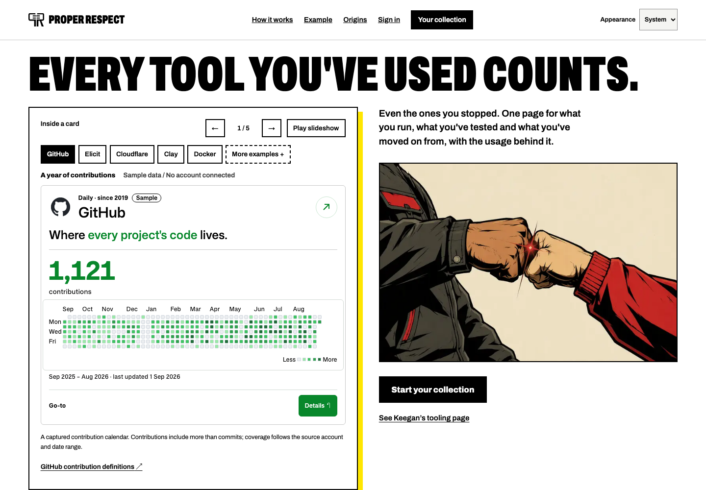

# Proper Respect

**Proper Respect is your tooling page: one link that shows every tool you use,
test and used before, with the usage behind it, so you earn respect for what
you actually run and give props to whoever put you on.**

[See a page](https://proper-respect.com/lecturesfrom) ·
[Start your collection](https://proper-respect.com/app/collection)



The card in the screenshot is sample data.

## What it is

- **Your page** is public, at `proper-respect.com/{handle}`. It shows the
  cards you approved and nothing else.
- **Your collection** is private. You add tools there, say how you use each
  one, and choose what to share. Nothing is published without your preview
  and approval.
- **A card** is one tool: how often you use it, since when, what you use it
  for, and the usage behind it where a source can supply it.
- **A tool you stopped using still counts.** Each card has one of seven usage
  levels, from Tried, didn't adopt to Daily.
- **Respect** is what your usage earns. **Props** is the credit a card gives
  the person who put you on that tool.

It is not an affiliate network, a review site or a ranking. A card can carry a
disclosed affiliate or referral link, and no person is scored or compared with
another. Usage is labelled with its source, period and coverage. It is backed
by your usage, and it is not independently checked.

## Where the usage comes from

A tool can be on your page without a number. What is available depends on the
source.

| Source | What it gives |
| --- | --- |
| GitHub | A contribution calendar, and a daily refresh you approve. |
| Claude Code | An import of a sanitized usage file you produce yourself. |
| Codex | An import of a metadata capture you produce yourself. |
| Other products | A measurement file in the `proper-measurements-v1` shape, in the product's own units. |
| Tools you add by name | How you use it, in your words. No telemetry needed. |
| Other uploads | Kept as supporting originals. The app does not read numbers out of them. |

[Usage measurement](docs/usage-measurement.md) has the exact formats, limits
and privacy boundaries.

## Run the project locally

Proper Respect runs on Next.js, Convex, and Clerk.

Two ways to run it locally:

1. **Fixture mode** (no accounts, about 5 minutes): the public pages with
   synthetic data. Good for UI work and reading the code.
2. **Full mode** (your own Convex and Clerk, about 30 minutes): sign-in,
   onboarding, a private collection and publishing, against a development
   backend of your own.

## Requirements

- **Node 24** (`.nvmrc`). With nvm: `nvm use`. Vercel, CI and the Convex Node
  actions all run 24.
- **npm**, which comes with Node.
- **Git.**

## 1. Fixture mode: no accounts

```bash
git clone https://github.com/keeganmoody33/PROPER-RESPECT.git
cd PROPER-RESPECT
npm ci
PROPER_RESPECT_E2E_REFERENCE=1 npm run dev
```

Don't create `.env.local` for this mode. With no Clerk or Convex keys, the app
serves synthetic data instead of calling a backend:

- `http://localhost:3000/`: the homepage.
- `http://localhost:3000/lecturesfrom`: a public page built from
  synthetic reference data (`src/data/e2e-reference-profile.ts`).
- `http://localhost:3000/evidence-fixture` and
  `http://localhost:3000/evidence-fixture/inventory`: fixture views of the
  evidence cards and the private collection.
- `http://localhost:3000/about/methodology`: how evidence works.

Sign-in, onboarding and anything that saves data need full mode.

The browser tests use this same mode (`playwright.config.ts`).

## 2. Full mode: your own Convex and Clerk

This uses a Convex **development** deployment and a Clerk **development**
instance, both yours. It never touches production.

1. **Install and copy the environment file.**

   ```bash
   npm ci
   cp .env.example .env.local
   ```

   `.env.local` is ignored by Git. Keep `PUBLIC_SITE_ORIGIN=http://localhost:3000`.

2. **Create a Convex dev deployment.**

   ```bash
   npx convex dev
   ```

   Log in and create a new project when asked. The command writes
   `CONVEX_DEPLOYMENT` and `NEXT_PUBLIC_CONVEX_URL` to `.env.local` and keeps
   running, pushing the functions in `convex/` as you edit. Leave it running in
   its own terminal.

3. **Create a Clerk development instance** at
   [dashboard.clerk.com](https://dashboard.clerk.com).
   - Copy its publishable and secret keys (`pk_test_…` and `sk_test_…`, both
     from the same instance) into `NEXT_PUBLIC_CLERK_PUBLISHABLE_KEY` and
     `CLERK_SECRET_KEY` in `.env.local`.
   - Open the Convex integration in the Clerk dashboard, select **Activate
     Convex integration**, and copy the Frontend API URL it shows
     (`https://<instance>.clerk.accounts.dev`).
   - Optional: enable GitHub under social connections, to try the GitHub
     connector.

4. **Give your Convex deployment its two server settings.** Enter each value
   when prompted, so it stays out of your shell history:

   ```bash
   npx convex env set CLERK_FRONTEND_API_URL
   npx convex env set CONNECTOR_ENCRYPTION_KEY
   ```

   Use the Frontend API URL from step 3, and a key from
   `openssl rand -base64 32`. Keep the key: connector credentials saved with
   it can't be read with a different one.

5. **Start the app** in a second terminal:

   ```bash
   npm run dev -- --hostname localhost
   ```

   Open `http://localhost:3000/onboarding`, sign in, and build a collection.
   Use `localhost`, not `127.0.0.1`, so Clerk accepts the session.

6. **Optional: seed the reference profile** into your dev deployment:

   ```bash
   npm run convex:seed
   ```

   It creates the synthetic `keegan` profile. Run it only against your own dev
   deployment.

Gmail discovery and Context.dev brand data need more server settings. Neither
is needed to try the app.

## Environment variables

Names only. `.env.example` has a placeholder and a comment for each, and
[`docs/DEPLOYMENT.md`](docs/DEPLOYMENT.md) says which runtime holds which
value. Never commit a real value.

| Variable | Where it is set | What it is for |
| --- | --- | --- |
| `NEXT_PUBLIC_CONVEX_URL` | Next.js | The Convex deployment the app talks to. |
| `PUBLIC_SITE_ORIGIN` | Next.js | The site's public origin, for canonical URLs and share images. HTTPS in production. |
| `NEXT_PUBLIC_CLERK_PUBLISHABLE_KEY`, `CLERK_SECRET_KEY` | Next.js | Clerk sign-in. |
| `NEXT_PUBLIC_CLERK_SIGN_IN_URL`, `NEXT_PUBLIC_CLERK_SIGN_UP_URL`, `NEXT_PUBLIC_CLERK_SIGN_IN_FALLBACK_REDIRECT_URL`, `NEXT_PUBLIC_CLERK_SIGN_UP_FALLBACK_REDIRECT_URL` | Next.js | Clerk's routes and where a person lands after signing in or up. |
| `CLERK_FRONTEND_API_URL` | Convex | The Clerk issuer Convex trusts. |
| `CONNECTOR_ENCRYPTION_KEY` | Convex | Encrypts stored connector credentials. Keep it: a new key can't read old credentials. |
| `MAILBOX_APPLICATION_ORIGIN`, `MAILBOX_ALLOW_LOOPBACK_HTTP` | Next.js and Convex | Gmail discovery's fixed origin. Optional. |
| `MAILBOX_GOOGLE_CLIENT_ID`, `MAILBOX_GOOGLE_CLIENT_SECRET`, `MAILBOX_ENCRYPTION_ACTIVE_VERSION`, `MAILBOX_ENCRYPTION_KEYS`, `MAILBOX_GOOGLE_TEST_EMAILS` | Convex | Gmail discovery, for listed test accounts only. Optional. |
| `CONTEXT_DEV_API_KEY` | Convex | Brand data for cards. Optional. |
| `PROPER_RESPECT_BRAND_RECEIPTS_DIR` | Local only | Reads saved brand receipts in a local preview. Optional. |
| `PROPER_RESPECT_E2E_REFERENCE` | Local and CI | Set to `1` for fixture mode. |
| `PROPER_RESPECT_E2E_PORT` | Local | The browser suite's port, default 3000. |

## Verify

```bash
npm run lint
npm run typecheck
npm test
PUBLIC_SITE_ORIGIN=https://public.example npm run build
npx playwright install chromium
npm run test:e2e
```

A production build accepts only an HTTPS `PUBLIC_SITE_ORIGIN`, so the build
line sets a placeholder; it overrides the `http://localhost:3000` in
`.env.local`, which `npm run dev` still uses. Use your real origin when you
build for a deployment.
`npm test` runs the Vitest suite (including the Convex backend tests) and the
Node script tests. `npm run test:e2e` starts the app in fixture mode itself.

## Deploy

A release is a `v*` tag on `main`, pushed by the owner. The release workflow
checks the tagged commit, deploys the Convex backend, then the Vercel frontend,
and smoke tests the live site. Nothing deploys from a branch, a pull request or
a development checkout. [`docs/DEPLOYMENT.md`](docs/DEPLOYMENT.md) has the
configuration, the release steps and rollback.

## Contribute

- Read [`AGENTS.md`](AGENTS.md) first. It holds the rules for anyone, human or
  agent, changing this repository, and [`CONTEXT.md`](CONTEXT.md) holds the
  words the product uses.
- Open a pull request against `main`. `main` is protected: three checks must
  pass, and the owner merges.
- Write the failing test first where behaviour changes.
- Run lint, typecheck, the tests and a build before you push (see Verify).
- Report a security problem privately to 33@lecturesfrom.com, not in an issue.

The repository is public and has no license yet, so all rights are reserved
until the owner picks one.

## Where to go next

- [`docs/DEVELOPMENT.md`](docs/DEVELOPMENT.md): the working guide and current
  delivery state.
- [`docs/plans/2026-11-17-public-ready.md`](docs/plans/2026-11-17-public-ready.md):
  the current plan.
- [`docs/000-current-product-thesis.md`](docs/000-current-product-thesis.md):
  what the product is for and its permission boundaries.
- [`docs/DEPLOYMENT.md`](docs/DEPLOYMENT.md): configuration, releases and
  rollback. Production changes are the owner's to make.
- `CONTEXT.md`, `PRD.md` and `INDEX.md`: domain language, requirements and a
  map of the docs.
- [`docs/history/README-2026-06.md`](docs/history/README-2026-06.md): the
  earlier product framing that used to live in this README.
